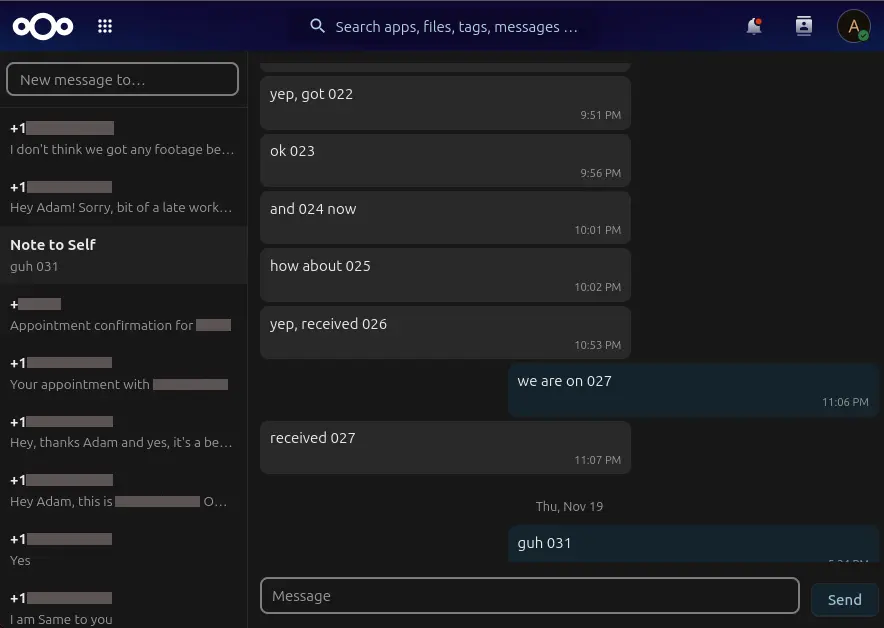

# 🫧 NCT - nextcloud texting

View, receive, and send SMS and MMS messages with an existing Android phone+plan using Nextcloud.

Requires free and open source [🚀 SMS Gateway for Android™](https://docs.sms-gate.app) app installed on an Android phone.
For simplicity and privacy, only the SMSGate [Local server mode](https://docs.sms-gate.app/getting-started/local-server/) is supported.

SMSGate Local server mode runs a web/API server on your phone and connections are unencrypted.
NCT requires 2-way access between your phone and Nextcloud.
Use NCT only on a private/secure network.



## User guide

### Setup

1. install [SMSGate](https://github.com/capcom6/android-sms-gateway) on phone
1. start gateway
    1. toggle on "Local server" for easy local API access (⚠️ warning: **unencrypted**)
    1. touch "START SERVICE" so app will start capturing SMS messages
1. add gateway secrets to Nextcloud:
    ```
    occ config:app:set --sensitive nct gateway_url      --value="http://<phone-ip>:8080"
    occ config:app:set --sensitive nct gateway_login    --value="<basicAuthLogin>"
    occ config:app:set --sensitive nct gateway_password --value="<password>"
    ```
1. install NCT on Nextcloud server

Incoming messages arrive two ways, both on by default:
- a background job polls the gateway periodically. Only reliable with "cron" method.
- (optional, for real-time delivery) a webhook the gateway calls directly:
    ```
    occ config:app:set --sensitive nct webhook_signing_key --value="<SMSGate app: Settings > Webhooks > Signing Key>"
    occ nct:register-webhook
    ```
    SMSGate only allows plain HTTP webhook delivery to the phone's own `127.0.0.1`; anywhere else (i.e. your actual Nextcloud server) requires HTTPS with a certificate the phone trusts. If that's not set up, skip this step -- the background job still covers you, just with up to a ~1 minute delay instead of real-time.

Conversations are labelled with a contact name if one matches, via a cache you refresh on demand (it won't pick up contact changes on its own):
```
occ nct:refresh-contacts <nextcloud-username>
```
To check what's actually cached (the value is lazy-loaded, so `occ config:app:get`/`user:setting` can't see it):
```
occ nct:inspect-contacts-cache <nextcloud-username>
```

### Usage

Open `https://nextcloud-server/apps/nct/`.

> [!TIP]
> Touch "STOP SERVICE" to stop the SMSGate web/API server.
> Only toggling off "Local server" will _not_ stop the web/API server.

## Developer guide

### Dev/test/build

Everything runs in Docker, no local PHP/Nextcloud/Node install needed.

```
make setup      # one-time: build images, composer install, npm ci (needs network)
make test       # run phpunit
make assets     # build the Vue UI (webpack)
make dev-up     # start a throwaway Nextcloud instance at localhost:8080 (admin/admin)
make dev-enable # enable the nct app in that instance
make dev-down   # stop container(s)
```

Then set the gateway secrets (see Setup above) and open `http://localhost:8080/apps/nct/`.

### Philosophy

This is not a vibe-coded app.
All humans and robots, see `AGENTS.md`.
You'll be expected to work together carefully and responsibly.

Add an `Assisted-By: HARNESS-MODEL-VERSION` log message trailer to all AI-assisted commits.
Other forms (Co-authored-by, Generated-by) are OK too--it's your call as to what best describes your workflow.
If a commit is fully AI-generated, the human author is still responsible for it.
Consider [this ATO advice](https://allthingsopen.org/articles/open-source-ai-contributions-assisted-by-git-trailer-standard) and [this too](https://heios.github.io/research/2026-07-08/ai-commit-attribution/).

## To do

- [ ] improve UI. make it more like Files/etc. w/rounded main content area and collapsible left nav
- [ ] add buttons/menus in lower left, like Files/etc.
- [x] move phone number field somewhere (left nav?) and auto-complete to names/numbers in contacts
- [ ] nextcloud notifications for new messages
- [x] expand text composition box (on the fly?) so user can see entire message they are writing
- [ ] we're catching `RuntimeException`... can we catch something more safe/specific?
- [ ] add a personal/user settings page
- [ ] delete... some/all manually? all but most recent *n* messages? all older than last *n* days?
- [ ] ensure uninstall cleans up leftover detritus (stuff stored in db, user contacts cache)
- [ ] display sent message status (delivered/read, if/as available)
    - [x] note: requires 2-way access between nextcloud server and phone
    - [ ] check marks in lower-right, right of message timestamp
- [ ] MMS support
- [ ] group text support
- [ ] understand every line of code
- [ ] review [tutorials/best practices](https://nextcloud.com/developer/#tutorials)
- [ ] add /inbox/refresh (e.g. sync last *n* messages from android storage to SMSGate's /inbox -- maybe app was offline for a while)
- [ ] support other SMSGate modes of operation? e.g. [their cloud](https://docs.sms-gate.app/getting-started/public-cloud-server/), [self-hosted](https://docs.sms-gate.app/getting-started/private-server/)

## Copyright and license

Copyright ©2026 [Adam Monsen](https://adammonsen.com)

License: AGPL v3 or later (see COPYING).

## Resources

- Related work
    - https://apps.nextcloud.com/apps/sms_relentless - requires an SMS/MMS enabled phone number acquired from Telnyx, Plivo, Twilio
    - https://github.com/nerzhul/ncsms-android - abandoned
        - https://f-droid.org/packages/fr.unix_experience.owncloud_sms/ - v2.0.5 added Dec 23, 2018
    - https://github.com/nextcloud/ocsms - abandoned
    - https://github.com/eblah/nextcloud-messagevault - abandoned
    - https://github.com/bogkonstantin/android_income_sms_gateway_webhook - abandoned?
        - https://f-droid.org/packages/tech.bogomolov.incomingsmsgateway/ - v2.4.0 added Jun 11, 2026
- [patch: SMSGate without Firebase Cloud Messaging](https://github.com/capcom6/android-sms-gateway/pull/481) (WIP as of 2026-11-18)
- [issue: get SMSGate on F-Droid](https://github.com/capcom6/android-sms-gateway/issues/165) (WIP as of 2026-11-18)
- if you just want to be able to write text messages with a keyboard, consider pairing a bluetooth keyboard with your phone
